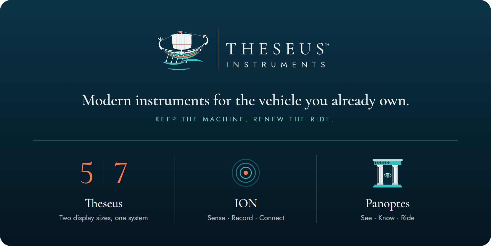

  

Theseus 5 and Theseus 7 pair an ION module that reads the machine with a Panoptes display that shows you what it finds. 
Built first for personal watercraft.

  <a href="https://theseusinstruments.com"><strong>theseusinstruments.com</strong></a>
  &nbsp;·&nbsp; <a href="https://theseusinstruments.com/theseus">Theseus</a>
  &nbsp;·&nbsp; <a href="https://theseusinstruments.com/technology">Technology</a>

